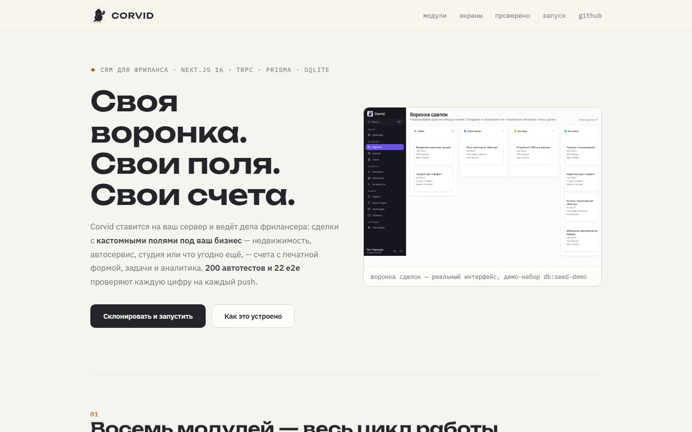

# Corvid CRM

> **Languages:** [English](README.md) · [Русский](README.ru.md)

CRM for freelance work: deals, invoices, clients, tasks, projects, activities and
analytics in one application. The full Russian documentation is in
[README.ru.md](README.ru.md).

**Site:** https://ssrjkk.github.io/corvid_crm/  
**Source:** https://github.com/ssrjkk/corvid_crm

## Screenshot



## Features

- Sales dashboard with monthly revenue, today's tasks and overdue items.
- Kanban pipeline with drag-and-drop and won/lost deal states.
- Deal cards with tasks, activities, tags, filters and CSV export.
- Invoices with line items, automatic numbering, statuses and PDF printing.
- Clients and companies with CSV import/export.
- Task list and Kanban board, calendar and project deadlines.
- Business templates, custom pipeline stages and custom fields.
- Command palette with global search.
- Light and dark themes.
- ADMIN, MANAGER and VIEWER roles.

## Quick start

```bash
git clone https://github.com/ssrjkk/corvid_crm.git
cd corvid_crm
npm install
cp .env.example .env
npx prisma migrate dev
npm run dev
npm run db:seed-demo
```

Set `DATABASE_URL`, `BETTER_AUTH_SECRET` and `BETTER_AUTH_URL` in `.env`.
The first user registered through `/sign-up` becomes ADMIN. Demo credentials are
documented in the Russian README; change them before any shared deployment.

## Checks

```bash
npm test
npm run lint
npx tsc --noEmit
npm audit
npm run build
npm run e2e
npx playwright test --project=a11y
```

CI also runs `npm run db:check` so the Prisma schema cannot drift from migrations.

## Data and backups

SQLite runs in WAL mode. Do not copy only `dev.db` while the application is running.

```bash
npm run db:backup
```

The script checkpoints WAL, copies the database, verifies the copy and rotates old
snapshots. Restore by stopping the server and replacing `dev.db` with a verified
backup.

## Stack

Next.js 16, React 19, TypeScript, Tailwind CSS v4, tRPC, TanStack Query, Prisma,
SQLite, Better Auth, Recharts, dnd-kit, Vitest and Playwright.

## Security

- Server-side role guards; the UI is not a trust boundary.
- Production fails closed without `BETTER_AUTH_SECRET`.
- Security headers and CSP are checked by E2E tests.
- CSV formula injection is neutralized and imports are size-limited.
- Dependency audit and schema drift checks run in CI.

## Deployment

The app can run on Vercel or a self-hosted Node server. Use PostgreSQL when several
devices need concurrent access. Apply migrations before starting the new build and
take a backup before migrating.

## Documentation

- [Russian README](README.ru.md)
- [Design system](.agents/skills/corvid-design/SKILL.md)
- [Security policy](SECURITY.md)

## License

MIT — see [LICENSE](LICENSE).
